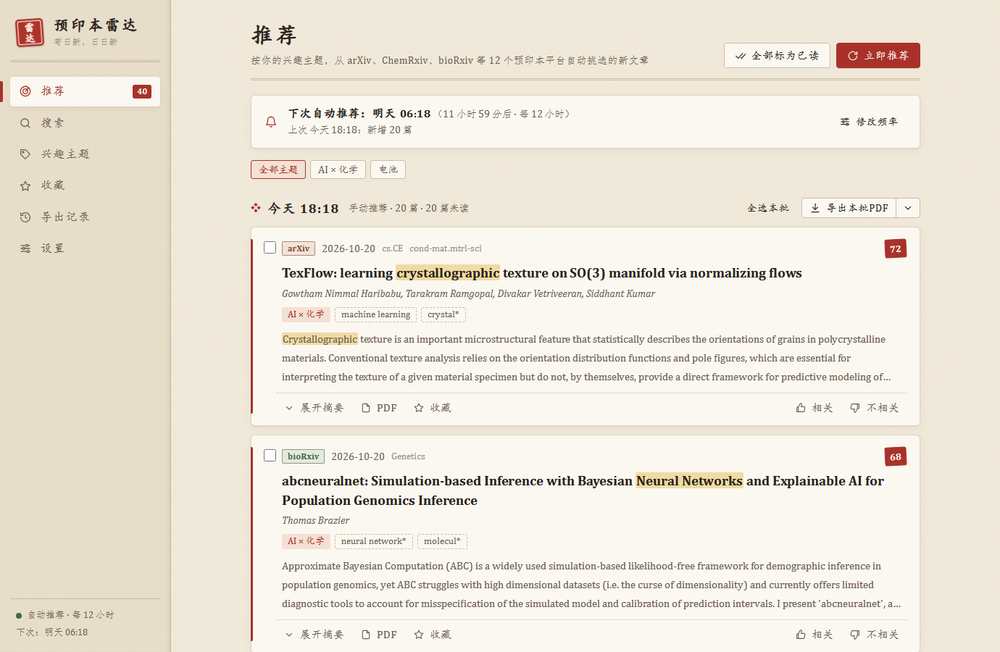
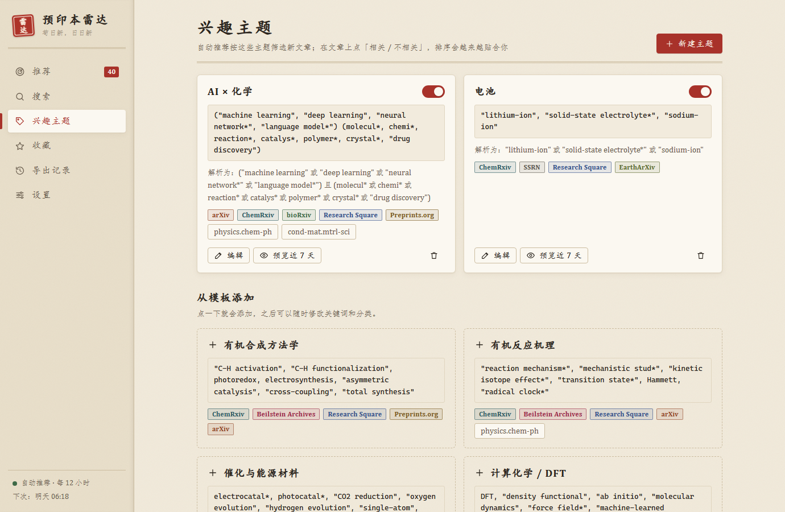

# 预印本雷达 · PreprintRadar

> 苟日新，日日新。—— 从 **arXiv、ChemRxiv、bioRxiv 等 12 个预印本平台**搜索最新论文，按你设定的时间自行推荐，勾选后一键导出 PDF。

**🌐 网页版（打开就能用）：<https://felixjiashengfu.github.io/PreprintRadar/>**　·　**💻 Windows 桌面版：[下载 PreprintRadar.exe](https://github.com/FelixJiashengFu/PreprintRadar/releases/latest)**



## 能做什么

- **随时搜索**：一次检索多个预印本平台；可选时间范围、范围（标题 + 摘要 / 仅标题 / 作者）和排序（最新 / 相关度），支持布尔语法（见下文）。
- **定时自行推荐**：在「兴趣主题」里写关键词、选平台（arXiv 还可以订阅分类），在「设置」里选 **每隔 N 分钟 / 小时 / 天** 或 **每天 HH:MM**，到点自动抓取、筛选、打分，有新文章就通知你。
- **越用越懂你**：在文章上点「相关 / 不相关」，排序会参考你的偏好。
- **一键导出 PDF**：合并成一个 PDF（自动生成目录页和书签）、逐篇 PDF、摘要清单。
- 收藏、导出记录，书香风格界面（浅色「宣纸」/ 深色「夜读」随系统切换）。



## 覆盖的预印本平台

| 平台 | 内容 | 每天新增（约） | 桌面版下载 PDF |
|---|---|---|---|
| arXiv | 物理、化学物理、材料、计算机、数学 | 900 | 自动 |
| ChemRxiv | 化学全领域 | 45 | 在浏览器中打开 |
| bioRxiv | 生物、生物化学、化学生物学 | 250 | 自动 |
| Research Square | 多学科（Springer Nature 在审稿件） | 410 | 自动 |
| Preprints.org | 多学科（MDPI） | 130 | 自动 |
| Beilstein Archives | 有机化学、纳米科学 | 每月几篇 | 自动 |
| medRxiv | 医学、药理 | 60 | 自动 |
| SSRN | 多学科（Elsevier；以社科为主） | 950 | 在浏览器中打开 |
| EarthArXiv | 地球科学、环境化学 | 7 | 自动 |
| ESS Open Archive | 地球与空间科学（AGU） | 14 | 在浏览器中打开 |
| Authorea | 多学科（Wiley） | 8 | 在浏览器中打开 |
| engrXiv | 工程 | 4 | 在浏览器中打开 |

前 6 个是默认勾选的「常用」来源，其他的可以在搜索页和主题里点选。TechRxiv 从 2026 年 4 月起不再向 Crossref 登记新论文，ChinaXiv 的数据接口拒绝外部访问，所以暂时没有收录。

数据来源：arXiv 用官方 API（网页版走 DataCite），其余平台用 Crossref 的公开元数据（每个预印本都有 DOI，摘要齐全，几分钟内就能查到）。

## 桌面版和网页版

| | 桌面版（Windows） | 网页版 |
|---|---|---|
| 搜索 12 个平台 | ✅ | ✅ |
| 兴趣主题、相关度排序、收藏 | ✅ | ✅（保存在你的浏览器里） |
| 定时推荐 | 程序在托盘里就会运行，可开机自启 | 只在网页开着时运行，关掉后再打开会补上 |
| 通知 | Windows 通知 | 浏览器通知 |
| 合并 PDF 里的全文 | 所有「自动」平台的 PDF | 只有 arXiv 的（其他平台不允许网页抓取），其余给出链接 |

## 桌面版使用

1. 双击 **`PreprintRadar.exe`**（不需要安装；数据存放在 `%LOCALAPPDATA%\PreprintRadar`）。
2. 在「推荐」页点一个模板（例如「AI × 化学」「有机合成方法学」），或者自定义主题。保存几秒后开始第一次推荐。
3. 勾选文章，在底部点 **「导出为一个PDF」**；每批推荐旁边也有「导出本批PDF」。
4. 在「设置」里修改推荐频率、每次篇数、导出文件夹、推荐后自动导出、通知、开机自启。

关闭窗口后程序还在右下角托盘里（红色“雷达”印章图标）。左键单击打开窗口，右键可以「立即推荐一次 / 暂停自动推荐 / 退出」。再次双击 exe 只会打开已经在运行的那一个。

## 关键词语法

| 写法 | 含义 |
|---|---|
| `machine learning` | 空格 = 且：两个词都要出现 |
| `"C-H activation"` | 引号 = 完整短语（C–H、C-H、CH 的写法都能匹配） |
| `photoredox, electrosynthesis` | 逗号、`OR`、换行 = 或 |
| `catal*` | 星号 = 前缀（catalyst、catalysis、catalytic…） |
| `-review` 或 `NOT review` | 排除 |
| `ti:perovskite`、`au:Kulik` | 只在标题 / 作者里找 |
| `(MOF, COF) "water harvesting"` | 括号组合 |

单复数自动匹配，化学式里的上下标也能识别（`"CO2 reduction"` 能匹配 CO₂ reduction）。编辑主题时会实时显示程序是怎么理解表达式的，「预览」可以先看看最近 7 天会推荐哪些文章。

## 只能在浏览器里下载的 PDF

ChemRxiv（2026 年迁到 Wiley 平台后）、SSRN、ESS Open Archive、Authorea、engrXiv 会用 Cloudflare 验证拦下程序，只让真实浏览器下载 PDF。桌面版导出时会把这些 PDF 在浏览器里打开；你存到下载文件夹后，程序会自动收进导出结果（最多等 5 分钟，也可以点「不等了，先导出」）。也可以把 PDF 直接拖到对应的文章卡片上。

小技巧：在浏览器里打开「始终下载 PDF 文件」（Edge：设置 → Cookie 和网站权限 → PDF 文档；Chrome：设置 → 隐私和安全 → 网站设置 → PDF 文档），PDF 就会直接存进下载文件夹。

## 数据与隐私

- 桌面版的数据都在本机：`%LOCALAPPDATA%\PreprintRadar`（数据库、PDF 缓存、日志）。网页版的主题和推荐只存在你自己的浏览器里，不经过任何服务器。
- 只访问各平台的公开接口（arXiv、Crossref、DataCite）和 PDF 地址，遵守访问礼仪（arXiv 每 3 秒最多 1 次，Crossref 每秒最多 1 次）。
- 桌面版的本地服务只监听 `127.0.0.1`，并校验请求来源；它信任 Windows 证书库，所以在 Norton 之类扫描 HTTPS 的杀毒软件或公司代理下也能联网。

## 卸载桌面版

1. 托盘图标右键 →「退出」。
2. 删除 `PreprintRadar.exe` 和 `%LOCALAPPDATA%\PreprintRadar`。
3. 开过开机自启的话：在设置里关掉，或删除 `shell:startup` 里的 `PreprintRadar.lnk`。
4. （可选）删除通知注册项：`reg delete "HKCU\Software\Classes\AppUserModelId\PreprintRadar.App" /f`

## 开发

只需要 [Deno](https://deno.com) 2.x：

```bash
deno task dev      # 运行桌面版源码（加 --port=8799 --no-window --data=<目录> 可隔离测试）
deno task test     # 单元测试
deno task web      # 构建网页版到 site/（推送到 main 后 GitHub Actions 自动发布到 Pages）
deno task build    # 打包 dist/PreprintRadar.exe
deno task icon     # 由 web/icon.svg 生成图标
```

| 文件 | 作用 |
|---|---|
| `src/engine.ts` | 抓取、匹配、打分、搜索——桌面版和网页版共用 |
| `src/sources/` | `registry.ts` 平台清单；`crossref.ts` 11 个 Crossref 平台；`arxiv.ts` arXiv API；`datacite.ts` 网页版的 arXiv |
| `src/query.ts`、`src/rank.ts` | 关键词语法（解析、本地匹配、翻译成各平台查询）与打分 |
| `src/main.ts`、`src/server.ts`、`src/db.ts` | 桌面版：本地服务、SQLite、调度、托盘、通知 |
| `src/exporter.ts`、`src/templates.ts`、`src/pdftext.ts` | 桌面版 PDF：下载缓存、合并、目录页与书签 |
| `src/web/` | 网页版：在浏览器里实现同一套 `/api/*`、localStorage 存储、浏览器内导出 |
| `web/` | 界面（原生 JS，桌面版和网页版共用） |
